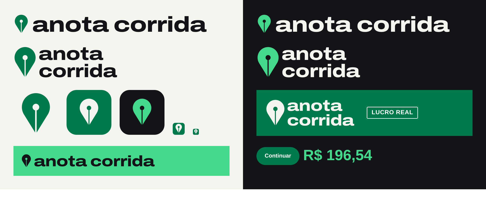

# Anota Corrida

O diário de bordo do motorista de aplicativo. Puxa as corridas da Uber, da 99 e da inDrive, desconta o custo real do carro e mostra quanto sobrou, os horários que mais rendem e quanto falta pra meta.

**Assinatura:** Você dirige. A gente anota.



- Design System (marca, tokens, guia de voz): https://claude.ai/artifact/SQU7pURWGcoXwxCBrdhuVF
- Canvas com Instagram, página de vendas e telas do app: https://claude.ai/artifact/9rAQiENN9YoM9iHbsdJxMe

## Símbolo: pino-pena

Um pino de mapa que também é a pena de uma caneta-tinteiro. O furo é o respiro da pena e a fenda abre a ponta em duas. O pino marca onde a corrida aconteceu; a pena anota.

## Cores

| Nome | Hex | Uso |
| --- | --- | --- |
| Verde Placa | `#007A4D` | Cor da marca, a das placas de rodovia. Botão, placa, ícone do app. Texto branco por cima. |
| Verde Sinal | `#43D98C` | Verde claro para números, linhas e destaques sobre o asfalto. Texto escuro por cima. |
| Asfalto | `#121417` | Fundo do app (o tema escuro é o padrão) e das peças escuras. |
| Papel | `#F4F4EE` | Fundo claro e das peças em papel. |
| Azul Caneta | `#2747D6` / `#9AAEFF` no escuro | Anotação à mão, setas e anel de foco. |
| Vermelho Freio | `#C4262E` / `#FF7A85` no escuro | Custo, queda, "não compensa". |

Verde é lucro: o estado positivo usa o mesmo verde da marca. Lucro e freio sempre aparecem com sinal, seta ou palavra, nunca só pela cor.

Os tokens completos, com os dois temas, estão em [`tokens.json`](tokens.json).

## Tipografia (Google Fonts)

- **Archivo Expanded 800** (`font-family: Archivo; font-stretch: 125%`): títulos curtos e o número principal de cada tela.
- **Archivo** 400 a 700: toda a interface.
- **Martian Mono** 500: rótulos de dado em caixa-alta (R$/KM, 07:12, 9,8 KM).
- **Caveat** 700: a anotação à mão, uma por tela ou post.

```html
<link rel="stylesheet" href="https://fonts.googleapis.com/css2?family=Archivo:wdth,wght@62..125,100..900&family=Caveat:wght@500..700&family=Martian+Mono:wght@400..700&display=swap">
```

## Logos

Todos em SVG, com o texto já convertido em curvas (não dependem da fonte instalada).

| Arquivo | Onde usar |
| --- | --- |
| `logo-horizontal.svg` | Sobre papel ou fundo claro |
| `logo-horizontal-negativo.svg` | Sobre asfalto |
| `logo-horizontal-mono-claro.svg` | Sobre o Verde Placa ou foto escura |
| `logo-horizontal-mono.svg` | Sobre o Verde Sinal |
| `logo-empilhado*.svg` | As mesmas regras, para espaço quadrado (avatar, adesivo) |
| `simbolo-*.svg` | Símbolo sozinho, onde a marca já foi apresentada |
| `app-icone.svg`, `app-icone-noite.svg` | Ícone do app, 1024 px |
| `favicon.svg` | 16 a 32 px, com furo e fenda mais grossos |

Tamanho mínimo: 112 px de largura no logo horizontal e 20 px no símbolo. Respiro em volta: a altura do "a" minúsculo do wordmark.

## Regerar os logos

Os scripts em `ferramentas/` desenham o símbolo e convertem o wordmark em curvas. Para trocar uma cor, mude as constantes no topo de `make_logos.py`.

```bash
pip install fonttools uharfbuzz
```

```bash
mkdir -p fontes saida && curl -sS -o fontes/archivo-125-800.ttf "$(curl -sS 'https://fonts.googleapis.com/css2?family=Archivo:wdth,wght@125,800' | grep -oE 'https://[^)]+\.ttf')"
```

```bash
python3 ferramentas/make_logos.py fontes saida
```

## Funcionalidades do conceito

- **Conecta e importa:** leitura dos ganhos no celular (Android) e importação do arquivo de dados que cada plataforma entrega pela LGPD. Quem já roda vê o histórico no primeiro dia.
- **Lucro real por corrida:** bruto menos combustível (pelo consumo do carro), desgaste por km, aluguel, parcela e o que mais for cadastrado.
- **Anota por voz:** "abasteci 120 de etanol" vira um lançamento com valor, tipo e litros.
- **Horário de ouro:** mapa de calor do lucro por hora da semana do motorista e comparador entre Uber, 99 e inDrive.
- **Meta e simulador "E se?":** projeção do mês e cenários como rodar uma hora a mais, converter pra GNV ou folgar no domingo, inclusive quando não compensa.
- **Radar de corrida:** avisa se a oferta vale a pena com o custo do carro do motorista.
- **Card do dia e Retrospectiva:** peças prontas pra compartilhar no WhatsApp e no Instagram.

Todos os números das telas e posts são exemplos.

Anota Corrida não é afiliado à Uber, 99 ou inDrive. As marcas citadas pertencem aos seus donos.
