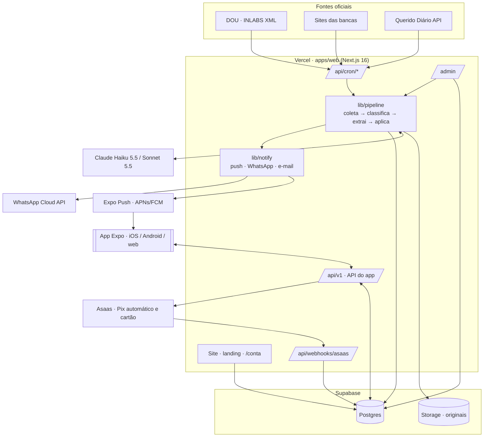

# Arquitetura · Aviso Concurso

## Decisões

| Tema | Escolha | Por quê |
|---|---|---|
| App | Expo (React Native) + Expo Router + TypeScript | Um código para iOS, Android e web; push nativo via Expo (APNs + FCM) sem custo por envio |
| Site, admin e API | Next.js 16 (App Router) + Tailwind v4 num único projeto | Um deploy na Vercel; mesmas regras e mesmo banco |
| Banco | Postgres (Supabase em produção) com SQL direto (`postgres`) | Sem ORM: consultas explícitas, rápidas, fáceis de revisar; migrações SQL versionadas |
| Autenticação | Própria: senha scrypt + JWT (jose) com sessões revogáveis no banco | Funciona igual no site (cookie httpOnly) e no app (Bearer), sem dependência extra; dá para trocar por Supabase Auth depois |
| Regras de negócio | `packages/shared` (TS puro, testado) | Fonte única para backend, site e app |
| IA | Claude Haiku 5.5 em toda extração e no Pergunte ao edital; Sonnet 5.5 nos difíceis; prompt caching do edital | Custo baixo (≈ R$ 0,04 por pergunta) com qualidade |
| Cobrança | Asaas (Pix automático e cartão), provedor plugável (`BillingProvider`) | Brasileiro, Pix automático; mock em desenvolvimento |
| Jobs | Vercel Cron chamando `/api/cron/*` com `CRON_SECRET` | Sem servidor extra; também rodam localmente por `scripts/job.ts` |

## Modelo de dados

Ver `apps/web/db/migrations/`. Núcleo: `users`, `sessions`, `subscriptions`, `payments`, `user_settings`, `devices`, `profiles` ·
coleta: `sources`, `source_runs`, `raw_documents`, `acts`, `extractions` · concursos: `contests`, `contest_roles`, `contest_dates`,
`subjects`, `contest_subjects`, `contest_versions` · uso: `follows`, `checklist_items`, `alerts`, `questions` · operação: `leads`, `audit_log`, `app_config`.

Garantias no próprio banco: e-mail único; uma assinatura viva por pessoa; `raw_documents.hash` único (coleta idempotente);
`contests.dedup_key` único; `alerts (dedup_key, canal)` único (aviso idempotente); `contests.url_oficial not null`.

## Ambientes

| Variável | Uso |
|---|---|
| `DATABASE_URL` | Postgres (Supabase: string do pooler) |
| `AUTH_SECRET` | assinatura das sessões |
| `APP_URL` | URL pública |
| `CRON_SECRET` | proteção dos jobs |
| `ANTHROPIC_API_KEY` | extração e Pergunte ao edital |
| `INLABS_EMAIL`, `INLABS_SENHA` | download do DOU |
| `BILLING_PROVIDER`, `ASAAS_*` | cobrança |
| `EXPO_ACCESS_TOKEN` | envio de push |
| `WHATSAPP_TOKEN`, `WHATSAPP_PHONE_ID` | WhatsApp Cloud API |
| `RESEND_API_KEY`, `EMAIL_FROM` | e-mail |
| `SHOW_EXEMPLOS` | mostra concursos de exemplo no site (só dev) |
| App: `EXPO_PUBLIC_API_URL` | URL da API |

## Custos de operação (do briefing)

Fixo ≈ R$ 400 a R$ 760/mês (Supabase Pro, Vercel Pro, IA, e-mail). Push: R$ 0. Por assinante: Aviso sobra ≈ R$ 9,40; Aprovado ≈ R$ 16,70.
Ponto de equilíbrio ≈ 65 assinaturas do Aviso.
